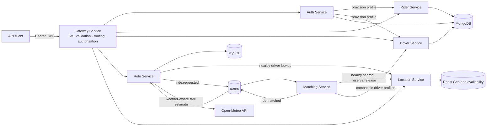
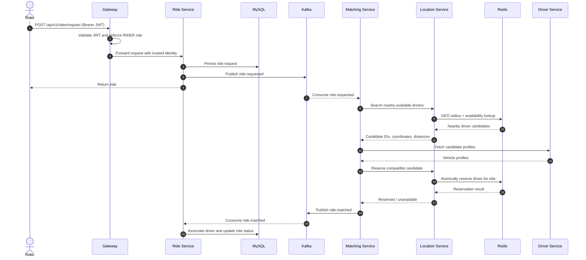
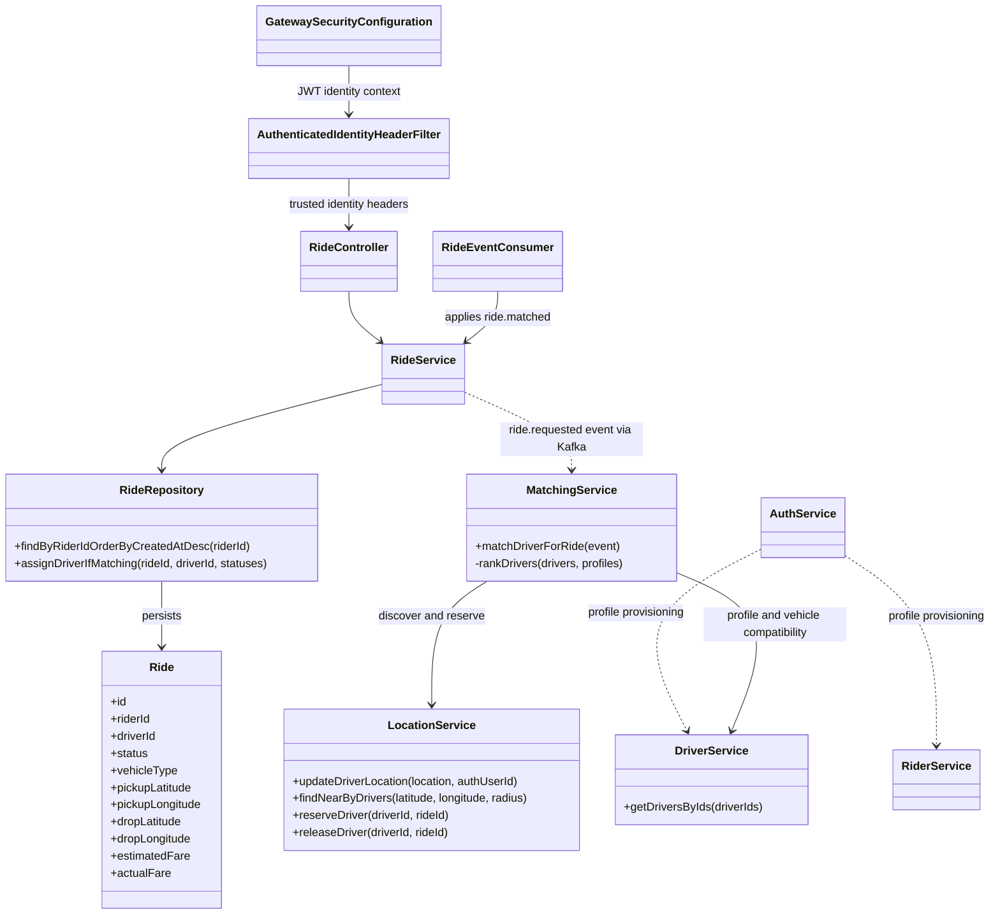
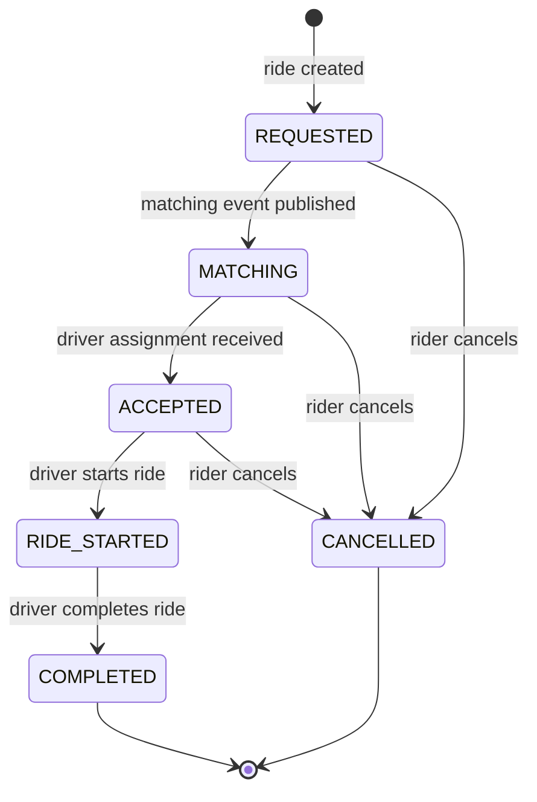

# FlashCab

FlashCab is a backend for a ride-hailing platform, built as a set of independently runnable Spring Boot services. It covers rider and driver accounts, authenticated API access, live driver locations, asynchronous driver matching, and the ride lifecycle. The repository focuses on backend services and local infrastructure; it does not contain a client application.

## Engineering highlights

- Validates JWT identity and role at the Gateway, strips client-supplied identity headers, and forwards identity derived from the verified token.
- Publishes ride requests and match results through Kafka so ride creation and driver matching run as separate service workflows.
- Uses Redis GEO for proximity search and Lua scripts for atomic driver reservation and release.
- Applies conditional database assignment only while a ride is still eligible for matching, preventing stale match events from overwriting a later ride state.

## Architecture

The API Gateway is the public entry point. It validates JWTs, applies role-based access rules, removes untrusted identity headers, and forwards authenticated identity to downstream services. The services use synchronous HTTP calls for profile and location lookups, and Kafka events to decouple ride requests from driver matching.



### Ride request and matching

Ride creation is handled synchronously by Ride Service; matching and assignment proceed through Kafka events. Location Service stores coordinates in Redis GEO and tracks availability and ride reservations separately.



### Domain and service responsibilities



## Services

| Service | Default port | Responsibility | Primary data / integration |
|---|---:|---|---|
| `gatewayService` | `8081` | Public API routing, JWT validation, role authorization, trusted identity headers, aggregated Swagger UI | Routes to application services |
| `authService` | `8087` | Rider/driver signup, login, signed JWT issuance, profile provisioning | MongoDB; Rider and Driver services |
| `riderService` | `8086` | Rider profile management | MongoDB |
| `driverService` | `8085` | Driver and vehicle profile management | MongoDB |
| `locationService` | `8082` | Driver location updates, nearby search, availability and reservations | Redis GEO; Driver Service |
| `rideService` | `8083` | Fare estimates, ride persistence and lifecycle | MySQL; Kafka; profile/location services; Open-Meteo |
| `matchingService` | `8084` | Asynchronous candidate filtering, ranking, reservation and assignment | Kafka; Location and Driver services |

### Ride lifecycle



## Technology

- **Java 17** and **Spring Boot** for the independently deployable services
- **Spring Cloud Gateway (WebFlux)** and Spring Security resource-server support for edge routing and JWT verification
- **Spring Cloud OpenFeign** for service-to-service HTTP clients
- **Apache Kafka** for `ride.requested` and `ride.matched` events
- **MongoDB** for authentication, rider, and driver documents
- **MySQL** with Spring Data JPA for ride records
- **Redis GEO** and Redis hashes/Lua scripts for location search and atomic driver reservations
- **Docker Compose** for local infrastructure and full-stack container startup
- **Springdoc OpenAPI** for API documentation through the Gateway

## API overview

Protected application requests go through `http://localhost:8081` and require `Authorization: Bearer <token>`. Signup and login are public.

| Method | Path | Purpose |
|---|---|---|
| `POST` | `/auth/signup` | Create a Rider or Driver account and provision its profile |
| `POST` | `/auth/login` | Authenticate and receive a JWT |
| `GET`, `PUT`, `DELETE` | `/api/v1/riders/{riderId}` | Read, update, or delete the authenticated rider's profile |
| `GET`, `PUT`, `DELETE` | `/api/v1/drivers/{driverId}` | Read, update, or delete the authenticated driver's profile |
| `POST` | `/api/v1/locations/drivers/update` | Update the authenticated driver's location |
| `GET` | `/api/v1/locations/drivers/nearby` | Find nearby available drivers |
| `POST` | `/api/v1/rides/request` | Create a ride request |
| `GET` | `/api/v1/rides/{rideId}` | Read a ride when authorized as its rider or driver |
| `GET` | `/api/v1/rides/rider/{riderId}` | List rides for the authenticated rider |
| `PUT` | `/api/v1/rides/{rideId}/start` | Start an assigned ride (Driver) |
| `PUT` | `/api/v1/rides/{rideId}/complete` | Complete a started ride (Driver) |
| `PUT` | `/api/v1/rides/{rideId}/cancel` | Cancel a ride (Rider) |

The Gateway Swagger UI is available at [http://localhost:8081/swagger-ui.html](http://localhost:8081/swagger-ui.html) when the stack is running. It aggregates Rider, Driver, Location, and Ride API documentation. The Matching Service is event-driven and does not expose a public REST API. Internal profile-provisioning and driver-reservation endpoints are service-to-service APIs, not Gateway routes.

## Run locally

### Prerequisites

- Java 17
- Docker with Docker Compose v2.24.0 or newer
- PowerShell (commands below use the Windows Maven wrapper)

### Start the complete stack

Clone the repository and prepare local configuration:

```powershell
git clone https://github.com/tusharAgarwal2511/flashcab.git
cd flashcab
```

Copy the templates for files that do not already exist. In PowerShell, from the repository root:

```powershell
$envFiles = @(
  '.env',
  'authService\.env',
  'driverService\.env',
  'gatewayService\.env',
  'locationService\.env',
  'matchingService\.env',
  'rideService\.env',
  'riderService\.env'
)
foreach ($file in $envFiles) {
  if (-not (Test-Path $file)) {
    Copy-Item "${file}.example" $file
  }
}
```

In the root `.env`, set unique local values for `FLASHCAB_MYSQL_ROOT_PASSWORD` and `FLASHCAB_MYSQL_APP_PASSWORD`. Set `AUTH_JWT_SECRET` and `GATEWAY_JWT_SECRET` to the same secret with at least 32 UTF-8 bytes. The example values are for local development only; never use them in a deployed environment.

Build and launch the services and dependencies:

```powershell
docker compose up --build -d
```

Only the Gateway is published by the default Compose configuration. To view service status and logs:

```powershell
docker compose ps
docker compose logs -f gateway-service
```

### Run services from an IDE

To run infrastructure in Docker and launch the seven Spring services locally from their module directories:

```powershell
docker compose -f docker-compose.yaml -f docker-compose.local.yaml up -d mongodb redis mysql kafka
```

The local Compose override binds infrastructure ports to `127.0.0.1`. Run each service's application entry point from its own module directory so its optional `./.env` file is resolved correctly.

For environment variables, secret handling, and deployment notes, see [ENVIRONMENT_SETUP.md](ENVIRONMENT_SETUP.md).

## Tests

Each service is an independent Maven project. Run its tests from the service directory:

```powershell
cd rideService
.\mvnw.cmd test
```

Repeat with `authService`, `driverService`, `gatewayService`, `locationService`, `matchingService`, or `riderService` as needed.

## Repository layout

```text
FlashCab/
├── authService/       # Authentication, JWT issuance, account provisioning
├── driverService/     # Driver and vehicle profiles
├── gatewayService/    # Public API gateway and authorization
├── locationService/   # Live locations, nearby search, driver reservations
├── matchingService/   # Kafka-driven driver matching
├── riderService/      # Rider profiles
├── rideService/       # Fare estimation and ride lifecycle
├── docker-compose.yaml
├── docker-compose.local.yaml
├── ENVIRONMENT_SETUP.md
└── FlashCabPostmanCollection.json
```

Import [FlashCabPostmanCollection.json](FlashCabPostmanCollection.json) into Postman to exercise the Gateway authentication and ride flows against a running local stack.